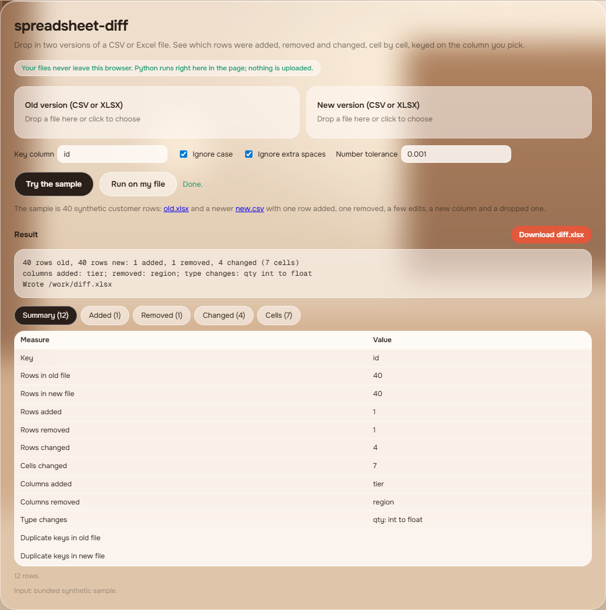

# spreadsheet-diff

[](https://github.com/chasebuilds/spreadsheet-diff/actions/workflows/ci.yml)  [](LICENSE)

**[Live demo: try it in your browser](https://chasebuilds.github.io/spreadsheet-diff/)**. Drop in your own file or run the bundled sample with one click. The real package runs in the page with Pyodide, so files never leave your browser.

[](https://chasebuilds.github.io/spreadsheet-diff/)

Compares two versions of a CSV or Excel file by a key column. It reports rows that were added, rows that were removed, and rows that changed, cell by cell with the old and new value. It also reports columns that were added or removed and columns whose type changed. The result is an Excel report with changed cells highlighted, plus an optional JSON summary. Everything runs offline.

## Measured result

A fake customer file with known planted changes was diffed and every result was checked against the planted list. The table below is written by the benchmark script from a real run, not typed by hand. Method and limits: [BENCHMARK.md](BENCHMARK.md).

<!-- benchmark:start -->
| Measure | Result |
|---|---|
| Rows (old file .xlsx, new file .csv) | 20,000 old, 20,030 new |
| Added rows | recall **100.0%** (600 of 600), precision **100.0%** (600 of 600) |
| Removed rows | recall **100.0%** (570 of 570), precision **100.0%** (570 of 570) |
| Changed rows | recall **100.0%** (1,377 of 1,377), precision **100.0%** (1,377 of 1,377) |
| Changed cells | recall **100.0%** (2,803 of 2,803), precision **100.0%** (2,803 of 2,803) |
| Noise rows flagged, with ignore options | 0 of 1,172 |
| Noise rows flagged, strict (no options) | 1,172 of 1,172 |
| Column added, removed and type change found | all 3 |
| Time to load both files and diff | 1.8 s |
<!-- benchmark:end -->

The planted edits are clean and the key never changes, so this is a best case. [LIMITATIONS.md](LIMITATIONS.md) lists what a real file can do to it.

## Quick start

Windows (on macOS or Linux use `.venv/bin/` in place of `.venv\Scripts\`):

```
python -m venv .venv
.venv\Scripts\python -m pip install -e .
.venv\Scripts\sdiff samples\old.xlsx samples\new.csv --key id -o samples\diff.xlsx --json samples\diff.json --ignore-case --ignore-whitespace --tolerance 0.001
```

The sample is 40 generated rows: `old.xlsx` and a newer `new.csv`. The command prints:

```
40 rows old, 40 rows new: 1 added, 1 removed, 4 changed (7 cells)
columns added: tier; removed: region; type changes: qty int to float
Wrote samples\diff.xlsx
Wrote samples\diff.json
```

Without the three ignore options the same files show 6 changed rows: the other 2 differ only in case, spaces or a gap under 0.001.

| Option | Effect |
|---|---|
| `--key COL` | key column; join several with commas for a composite key (`--key region,id`) |
| `-o FILE` | Excel report (default `diff.xlsx`) |
| `--json FILE` | also write a JSON summary |
| `--sheet NAME` | sheet to read from Excel files (default: the first) |
| `--ignore-case` | `Ann` and `ANN` count as the same |
| `--ignore-whitespace` | leading, trailing and repeated spaces do not count |
| `--tolerance N` | numbers no more than N apart count as the same (default 0) |

Exit codes, like `diff`: `0` no differences, `1` differences found, `2` a file or the key column could not be read.

## The output

| Sheet | What it holds |
|---|---|
| Summary | key, row counts, rows added, removed and changed, cells changed, columns added and removed, type changes, duplicate keys |
| Added | rows only in the new file |
| Removed | rows only in the old file |
| Changed | changed rows with their new values; changed cells are yellow and carry a comment with the old value |
| Cells | one line per changed cell: key, column, old, new |

The JSON summary has the same counts, the added and removed keys, and every changed cell as `{"key": {"column": {"old": ..., "new": ...}}}`.

## How values are compared

| Case | Rule |
|---|---|
| Numbers | compared as numbers, so `3`, `3.0` and `"03"` are equal; `--tolerance` sets the allowed gap |
| Dates | an Excel date and the text `2026-01-02` are equal |
| Text | exact, unless `--ignore-case` or `--ignore-whitespace` is on |
| Empty | an empty cell and an empty string are equal |
| Column types | each column gets `int`, `float`, `date`, `bool`, `text` or `mixed` from its non-empty cells; a different type in the new file is a type change |

Only columns in both files are compared cell by cell. A key that appears twice keeps its first row and is listed under duplicate keys.

As a library:

```python
from spreadsheet_diff import Options, compare, load

d = compare(load("old.xlsx"), load("new.csv"), ["id"], Options(ignore_case=True))
d.summary()["rows_changed"]
for cells in d.changed.values():
    for c in cells:
        print(c.key, c.column, c.old, c.new)
```

## Limits

Short version: rows are matched only by the key, so a row whose key changed shows up as one removed and one added. There is no fuzzy matching and no moved-row detection. Full list: [LIMITATIONS.md](LIMITATIONS.md).

## Development

```
.venv\Scripts\python -m pip install -e ".[dev]"
.venv\Scripts\python -m pytest --cov
.venv\Scripts\python -m ruff check .
.venv\Scripts\python -m mypy
.venv\Scripts\python -m benchmark.run_benchmark
```

The sample files were made with `python -m benchmark.generate --seed 7 --rows 40 --out samples`.

## License

MIT. See [LICENSE](LICENSE).
